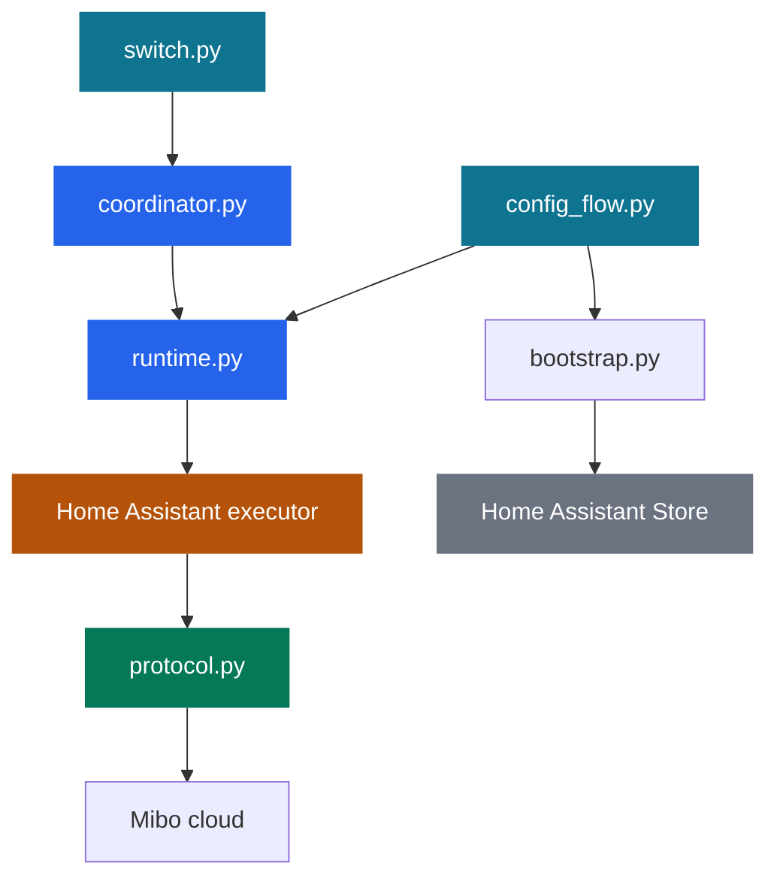
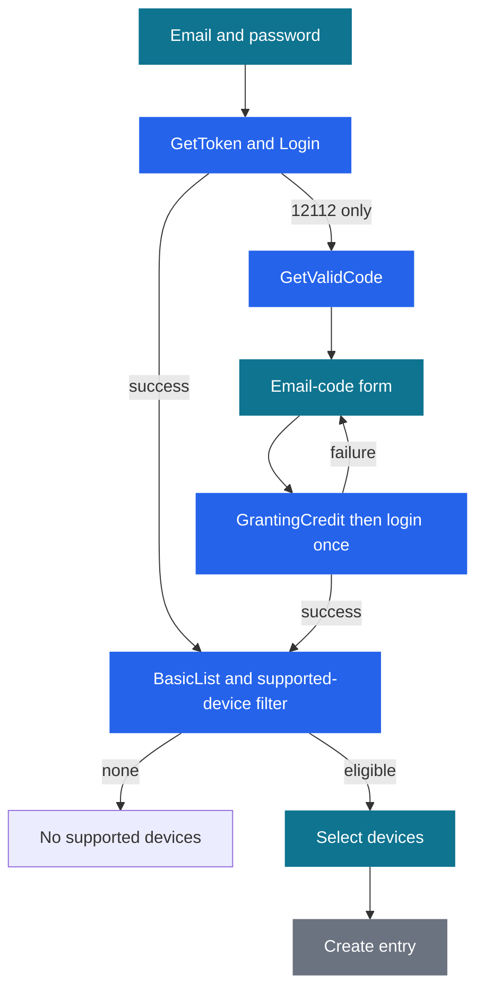
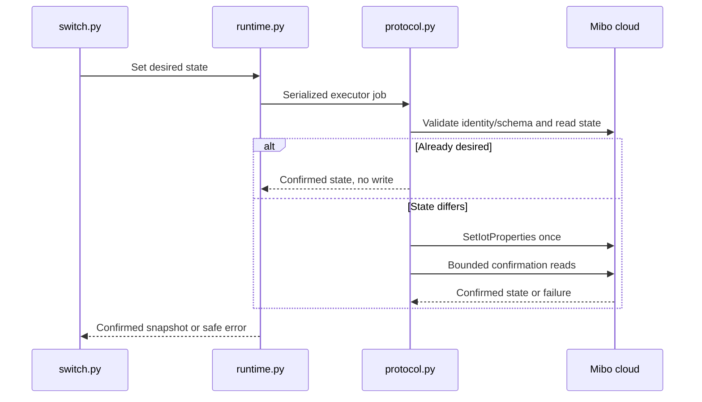
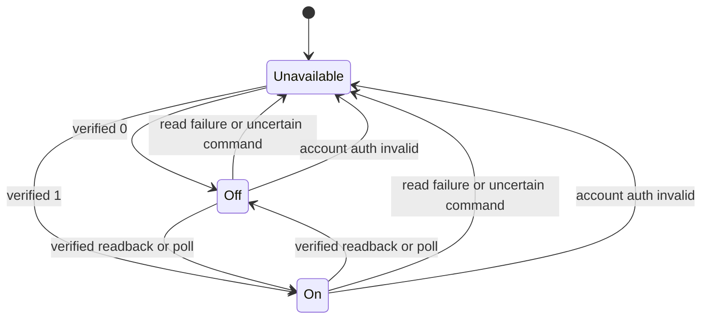
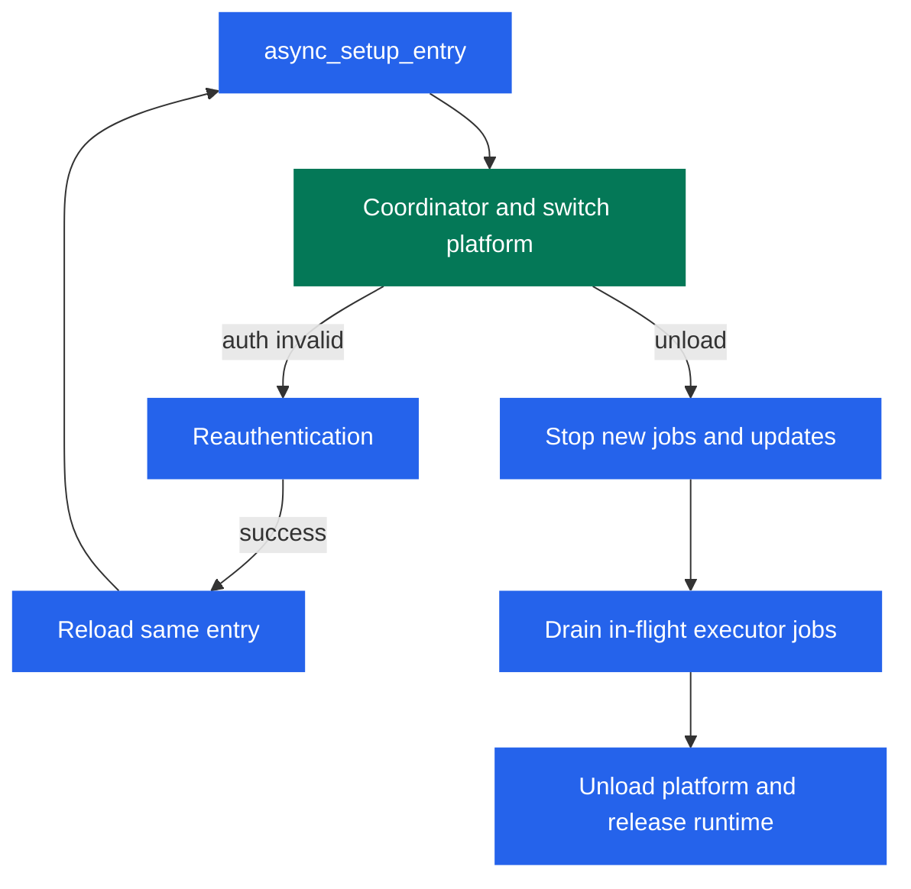
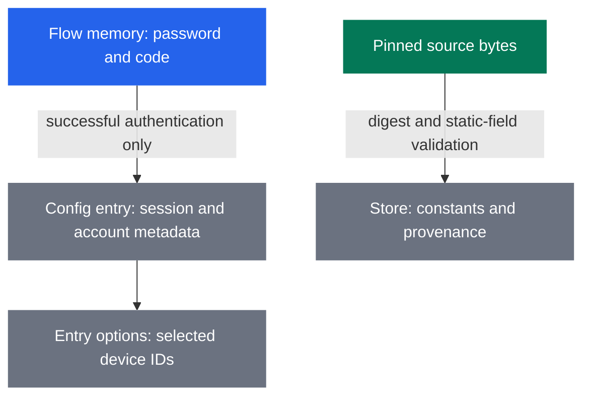

# Intelbras Mibo Home Assistant Integration - Plan

**Target repository:** `ha-intelbras-mibo`.

## Goal Capsule

- **Objective:** Other Home Assistant users can install the integration, sign into their own Mibo account, and control the first key of their supported Intelbras switch from Home Assistant.
- **Means:** Native custom integration and HACS custom-repository packaging, governed by R1–R3 and KTD1.
- **Authority:** The Product Contract owns behavior; technical decisions own implementation within it. `AGENTS.md` governs repository and live-access constraints.
- **Execution profile:** One feature PR from `feat/hacs-integration`, with six dependency-ordered units. The parent implements through workers, integrates, verifies, and reviews the complete change.
- **Delivery boundary:** The parent creates the public repository and publishes the bootstrap main branch plus the feature PR after verification and review. The user merges. This work neither merges the PR nor publishes a release.
- **Stop conditions:** Stop for evidence that the agreed support boundary cannot work, an unavoidable credential leak, or a live operation outside R11. Missing live credentials blocks live validation, not offline implementation.

---

## Product Contract

### Summary

Provide a community-maintained Intelbras Mibo integration with Home Assistant setup forms, email verification when required, device selection, and first-key switch entities. Package the integration so another installation can copy it directly or install it through a HACS custom repository once the implementation is on the default branch.

### Problem Frame

The working switch protocol currently serves a local CLI. Other Home Assistant users need their own account setup and normal switch entities without installing that CLI or depending on its private configuration.

### Key Decisions

- **Separate shareable project.** Governs R1, R10. (session-settled: user-directed — chosen over one-off home configuration: other users must be able to use it.)
- **Native Home Assistant integration.** Governs R2, R3. (session-settled: user-approved — chosen over a CLI wrapper, MQTT bridge, or add-on: setup and control belong in Home Assistant.)
- **Independent accounts and installation.** Governs R1, R4. (session-settled: user-approved — chosen over dependency on private CLI state: every installation uses its own account.)
- **EIW 1003 first key only.** Governs R5, R6. (session-settled: user-approved — chosen over other keys, master control, and cameras: only property 11900 has physical validation.)

### Requirements

**Distribution**

- R1. All runtime files live under `custom_components/intelbras_mibo/`; installation must not require a CLI, private repository, subprocess, separate service, or separately published Python package.
- R2. Expose the domain `intelbras_mibo` with the title `Intelbras Mibo`, explicitly described as an unofficial community integration.
- R3. Supply a working manual-copy installation and HACS custom-repository layout, portable documentation, MIT license, preserved upstream attribution, automated tests, and validation workflows.

**Account setup**

- R4. Setup accepts email and a hidden password, asks for an email code only after the proven 12112 challenge, then discovers devices and requires selection of at least one supported device before creating an entry.
- R5. Discovery offers only supported EIW 1003 identities and exposes one switch for key 1 per selected device; device names need not be unique.
- R6. Device selection can be changed through options, with at least one selection required; renames and list reordering must preserve entity identity.
- R7. Expired or rejected authenticated sessions trigger same-account reauthentication, preserving selected devices and entity identities; no password or verification code is persisted.

**Control and state**

- R8. Switch state reflects a verified cloud property read, polling by default every 30 seconds and confirming state after a command; an unavailable or unconfirmed result must not be presented as a successful on/off state.
- R9. Each user command sends at most one write, with no automatic replay after an uncertain result; a failure on one device does not make healthy devices unavailable unless the account itself fails.

**Privacy and verification**

- R10. Public artifacts contain no real account credentials, device identifiers or names, private addresses or paths, vendor application-key literals, or private repository links; automated fixtures use synthetic values only.
- R11. Only the parent performs live cloud validation, limited to read-only discovery and key 1 of the privately identified authorized switch; existing Home Assistant authentication, Frigate, MQTT, networking, and other components remain intact.
- R12. Setup, restart, reauthentication, options, unload, and reload use supported Home Assistant APIs and storage helpers; installing this component must not require manual authentication-storage edits.

### Acceptance Examples

- AE1. Covers R4, R7. Given an account requiring terminal trust, setup requests a code, accepts the valid code, then shows device selection; aborting before selection creates no entry and retains no durable password or code.
- AE2. Covers R5, R6. Given two supported devices with the same name and a camera, selection distinguishes the devices by stable identity, excludes the camera, and preserves entity IDs after a rename.
- AE3. Covers R8, R9. Given a write whose response times out, the entity becomes unavailable and the user sees a safe error; later polling may restore state without resending the write.
- AE4. Covers R7, R12. Given a saved token rejected with a proven auth-invalid signal, Home Assistant requests reauthentication and reloads the same entry after success.

### Scope Boundaries

No camera entities, keys 2/3, master switch, local-LAN protocol, generic property editor, YAML credentials, session-file import, custom frontend, extra services, health entities, or automatic write retries.

No HACS catalog acceptance claim, release automation, version tag, or `v0.1.0` release in this PR. These are separate from making the custom-repository layout valid.

Considered and not built: adaptive polling and automatic token refresh. The available protocol has no validated refresh contract, and a fixed interval with visible availability is sufficient for the initial devices. Revisit only with documented refresh behavior or measured cloud-rate pressure.

### Success Criteria

A fresh fake-backed Home Assistant instance completes setup and exposes the selected switch entities using only the installed component. The parent separately verifies the authorized live device through normal Home Assistant setup and control, or records the exact missing private prerequisite without claiming live success.

---

## Planning Contract

### Assumptions

The initial compatibility target is Home Assistant 2026.10.4 on Python 3.14.9. Support for other versions is unclaimed until tested. One configuration entry per canonical email/account is sufficient. Empty discovery ends with a clear `no_supported_devices` result rather than creating an empty entry. Options change selections, not the polling interval.

### Key Technical Decisions

- KTD1. **Embed the proven protocol in the component.** Copy the transport, signing, auth primitives, device parsing, and switch logic into `protocol.py` and `bootstrap.py`; replace CLI storage and presentation rather than importing them. This implements R1–R3 with no runtime package publication. (session-settled: user-approved — chosen over the private CLI dependency: installations must remain independent.) Preserve `NOTICE` both at the root and inside the distributed component.
- KTD2. **Run complete synchronous jobs in Home Assistant's executor.** Keep the validated synchronous protocol instead of rewriting it around async HTTP. A component-owned runner registry keyed by canonical account identity shares serialization across setup/reauth flows and the loaded entry for each entire discovery, read, login stage, or command transaction, including readback. The lock must remain held inside the executor operation if its awaiting coroutine is cancelled; a thread-owned lock and a closing flag are sufficient. Do not hold it while waiting for user input. Stop new entry jobs during unload, prevent late results from updating unloaded entities, and drain in-flight executor work before completing unload or allowing a replacement entry runtime to start. Preserve account serialization until the last runner reference is released. This is a routine adaptation, not a bake-off: async rewriting adds protocol risk without eliminating serialization. Follows the [blocking-operation guidance](https://developers.home-assistant.io/docs/asyncio_blocking_operations/).
- KTD3. **Split MFA across normal config-flow steps.** Adapt login/request-code/grant-code/login into finite executor jobs instead of the CLI's blocking code callback. Keep credentials only in flow memory, clear references on completion/abort, and do not log form inputs. Failed code submission stays on the code form without automatically resending email; an exhausted flow can be restarted. Use a generated terminal ID retained through all stages. A flow owns its temporary client while sharing the account runner; MFA must not replace the loaded entry client with anonymous/login credentials. Reject duplicate account entries and concurrently duplicated flows before completing setup; reauthentication uses the entry's account identity and terminal ID. Follows the [config-flow contract](https://developers.home-assistant.io/docs/config_entries_config_flow_handler/).
- KTD4. **Keep session and metadata distinct.** Config-entry data contains validated token username, token, optional session ID, terminal ID, allowlisted host, and nonsecret account identity metadata. Selected stable device IDs belong in entry options. Email is private setup/reauth metadata, never a public fixture. Use a canonical trimmed, case-folded email for duplicate-account identity; keep the entered address for protocol requests. Derive a stable SHA-256 account namespace from that canonical identity for registry identifiers, so separate accounts exposing the same cloud device do not collide. Keep this namespace unchanged during same-account reauthentication. Runtime reconstruction uses the token-session path, never a saved password. Only a successful reauth replaces session data. Store no raw discovery payloads.
- KTD5. **Load application constants from pinned, verified source.** Fetch only `https://raw.githubusercontent.com/Saeger/MiboMac/9ef8108e3992b60ff4ef0d9e1d84b8fc6e8e020f/Sources/App/MiboAPI.swift`, requiring SHA-256 `be30e1c992a73a1d35515e084cf418e8e8a82b10a4e9d8228b08b5b5e0c394f4`. Extract exactly the six static string fields `appId`, `defaultAK`, `defaultSK`, `clientVersion`, `project`, and `protocolVersion`; never execute downloaded code. Save only validated constants plus source/digest/schema provenance through an integration-owned Home Assistant Store. Validate every cache load against the pinned provenance. A valid immutable cache needs no time-based refresh; absent/invalid cache requires a fresh verified fetch or a safe setup failure. Bootstrap I/O and hashing stay off the event loop. Never include constants in logs, diagnostics, fixtures, or distributed files.
- KTD6. **Retain proven request boundaries.** Cloud requests use HTTPS, only `app-br.easy4ipcloud.com` or `app-sp2.easy4ipcloud.com`, optional port 443, the explicit `/pcs/v1/` API allowlist, no redirects or environment proxies, a 20-second timeout, and a 2 MiB response limit. Preserve HMAC canonical ordering and double-MD5 password authentication. Preserve MFA API revisions 61452/82197, default model revision 191204, and property revision 56906. HTTP 401 and authenticated-session API 12112 mean reauthentication; 403 and other numeric codes are not guessed to mean expiry. Safe typed errors contain no provider descriptions or raw response bodies.
- KTD7. **Select by stable device ID and validate the key-1 contract.** Supported models are exactly `IOT-EIW1003-IB` and `EIW1003`, with a nonempty product ID, empty channel list, and integer channel count zero. Parse `QueryModelInfo.modelJson` as either a mapping or JSON string, using an empty gray flag fallback. Require exactly one bool/rw `switch` property with ref `11900`. Preserve the validated product-ID property request shape with no channel ID; parse only integer/string 0/1 from `data.properties`. An unsupported row is excluded without hiding valid rows; duplicate stable identities are rejected. Revalidate identity/schema before a write. Do not reuse CLI nickname fallback selection in the integration.
- KTD8. **Use one coordinator per account with per-device snapshots.** `entry.runtime_data` owns the client, serialized runner, and coordinator. Refresh selected devices together; use one discovery result per refresh to avoid repeating list calls for each device. Device-specific read/schema errors become unavailable snapshots, while account auth failures raise `ConfigEntryAuthFailed` and shared connectivity/list failures become `UpdateFailed`. Setup can load entities unavailable after valid discovery if individual reads fail. Commands preserve the existing no-op-when-already-set behavior and bounded confirmation of up to three reads within the existing five-second polling window; each network request still has KTD6's timeout. Publish only confirmed readback, then resume ordinary polling. Unique IDs derive from the KTD4 account namespace, device ID, and `11900`; device-registry identifiers derive from domain, account namespace, and device ID. Follows [coordinator guidance](https://developers.home-assistant.io/docs/integration_fetching_data/) and [setup failure handling](https://developers.home-assistant.io/docs/integration_setup_failures/).
- KTD9. **Ship an ordinary custom-repository package.** Use a versioned `manifest.json` with `config_flow`, `cloud_polling`, documentation/issue URLs, and actual code owner; no runtime requirements beyond Home Assistant's environment. Root `hacs.json` declares the integration name and tested minimum Home Assistant version. Target the proposed public repository `https://github.com/FidelisClayton/ha-intelbras-mibo`; verify its existence before public links are presented as usable. Follow [HACS integration structure](https://www.hacs.dev/docs/publish/integration/) and [validation action](https://www.hacs.dev/docs/publish/action/). Default-branch installation instructions become applicable after merge; pre-merge verification copies the feature component into a test instance.
- KTD10. **Pin tests to the deployed core.** Pin Home Assistant 2026.10.4 and `pytest-homeassistant-custom-component==0.13.375` on Python 3.14.9. The [helper release](https://github.com/MatthewFlamm/pytest-homeassistant-custom-component/releases/tag/0.13.375) pairs with that Core version; Core's [tagged manifest](https://github.com/home-assistant/core/blob/2026.10.4/pyproject.toml) requires Python >=3.14.2. Use fake transport and `enable_custom_integrations`; prohibit live network in tests. Set the pytest async mode required by the helper. Run CI tests plus hassfest and HACS validation; choose current action commit pins during implementation, recording the resolved versions rather than inventing SHAs here.

### High-Level Technical Design

Proposed component ownership, derived from the audited `Client`/`Switches` boundary and Home Assistant config-entry/coordinator APIs:

Setup protocol and decision points, derived from `Client.login`, `Client.mfa`, and KTD3:

Command transaction, derived from `Switches.set` and KTD8:

Entity state transitions, derived from the coordinator availability contract and R8–R9:

Entry lifecycle, derived from Home Assistant setup/unload APIs and KTD2/KTD8:

Persistent-data boundary, derived from the session/bootstrap shapes and KTD4/KTD5:

### Output Structure

The new component contains `__init__.py`, `manifest.json`, `const.py`, `protocol.py`, `bootstrap.py`, `runtime.py`, `config_flow.py`, `coordinator.py`, `switch.py`, `strings.json`, `translations/en.json`, `translations/pt-BR.json`, and `NOTICE`. Repository tooling consists of `hacs.json`, `pyproject.toml`, `requirements-dev.txt`, `scripts/check`, `.github/workflows/validate.yml`, and `tests/`. User/developer documentation lives in `README.md`, `docs/development.md`, and `docs/protocol.md`.

### System-Wide Impact and Risks

All persistent changes are integration-owned entries, options, registry records, and the bootstrap Store; Home Assistant manages their storage. Removing an entry releases its runtime without deleting unrelated data. Options reload the entry and remove/unload deselected entities through normal registry/platform APIs; selected unavailable devices remain represented so identities recover.

The cloud protocol is reverse-engineered. A changed source digest, schema, host, or auth response fails visibly rather than expanding the allowlist or guessing a new protocol. First setup depends on the pinned public source being reachable; later starts can use its validated cache. State confirmation establishes cloud state, not independent physical observation.

The synchronous core's transport deadline bounds individual requests, not a whole multi-device refresh. Normal coordinator scheduling prevents overlapping polls; cancellation must not release command serialization early. Additional retries, pacing, and larger-account optimizations are excluded unless testing demonstrates a concrete need within R8–R9.

---

## Implementation Units

### U1. Component package and reproducible test environment

**Goal:** Make the independent component importable and establish its verification environment.

**Requirements:** R1–R3, R10. **Dependencies:** None.

**Files:** `custom_components/intelbras_mibo/{__init__.py,manifest.json,const.py,NOTICE}`, `hacs.json`, `pyproject.toml`, `requirements-dev.txt`, `tests/{__init__.py,conftest.py}`, `.github/workflows/validate.yml`, `scripts/check`.

**Approach:** Implement KTD9–KTD10; preserve root `LICENSE`/`NOTICE`. The runtime package has no dependency on source-checkout paths. Establish the shared fixtures and component constants here; later units own their feature files. CI runs fake-backed tests and validation separately so repository-availability errors are distinguishable from component errors.

**Patterns to follow:** HACS integration layout and the pinned custom-component test helper.

**Test expectation:** No new behavioral unit tests for packaging; verify component discovery/import in the pinned environment and validate metadata.

**Verification:** The documented check entrypoint runs reproducibly with no account/config mounts. hassfest accepts the package; HACS structural checks pass when the public repository is reachable.

### U2. Embedded protocol and private bootstrap cache

**Goal:** Preserve the proven account and key-1 protocol without CLI state or secrets in the package.

**Requirements:** R1, R4, R5, R7–R10. **Dependencies:** U1.

**Files:** `custom_components/intelbras_mibo/{protocol.py,bootstrap.py}`, `tests/{test_protocol.py,test_bootstrap.py}`.

**Approach:** Apply KTD1 and KTD5–KTD7. Reuse the audited signing/transport tests with synthetic material; expose auth stages suitable for U3. Separate device identity parsing from repeated list retrieval so U4 can share one discovery snapshot. Translate safe protocol errors at the HA boundary, keeping protocol code independent of HA entry lifecycle.

**Execution note:** Preserve behavior with fake-transport characterization tests before adapting the synchronous core.

**Patterns to follow:** Audited `Client.call/login/mfa/from_session`, `Switches._schema/_read/set`, and the pinned-source static extractor; the public upstream source and root `NOTICE` are the portable provenance.

**Test scenarios:**

1. Deterministic date/nonce and synthetic credentials reproduce canonical signing and auth/MFA request versions.
2. Reject non-allowlisted hosts, redirects, proxies, oversized responses, malformed response data, and repeated pagination cursors without leaking response bodies.
3. Map authenticated HTTP 401/API 12112 to auth invalid; preserve other errors, including 403, without invented expiry handling.
4. Accept mapping/string model JSON, empty gray flag, and integer/string 0/1; reject mismatched schema, duplicate identities, channel metadata, keys other than 1, and nonboolean writes.
5. Bootstrap accepts only the pinned source digest and exactly six literal fields; missing fields, duplicate fields, hash mismatch, and invalid cache provenance fail safely.
6. A valid cached bootstrap works without downloading; failed cold bootstrap produces a sanitized setup error. Real constants never appear in fixture content or captured logs.
7. A no-op command makes no write; an uncertain write makes exactly one write; acknowledged but unconfirmed state remains a distinct failure.

**Verification:** Protocol and bootstrap tests pass using fake transport and synthetic source bytes, with no external network or local configuration dependency.

### U3. Account runtime, setup, MFA, reauthentication, and options

**Goal:** Configure an account and its selected devices through Home Assistant forms.

**Requirements:** R4–R7, R10, R12; AE1, AE2, AE4. **Dependencies:** U2.

**Files:** `custom_components/intelbras_mibo/{runtime.py,config_flow.py,strings.json,translations/en.json,translations/pt-BR.json}`, `tests/{test_runtime.py,test_config_flow.py}`.

**Approach:** Implement KTD2–KTD4. Config flows and later entity operations use the same account runner boundary. Populate device selectors with stable IDs and disambiguated labels. Options rediscover supported devices, preserve existing selections on errors, and retain missing selected IDs as unavailable choices until explicitly removed. Update selections only after successful validation. Reauthentication verifies the original account and updates the existing entry.

**Patterns to follow:** Native config-flow, options-flow, and reauth helpers in the pinned Home Assistant API.

**Test scenarios:**

1. Covers AE1. Successful non-MFA and MFA flows create an entry only after a nonempty valid selection; no password or code enters entry data, options, Store, or logs.
2. Wrong login, wrong/empty code, bootstrap failure, discovery timeout, no supported devices, and user abort return the correct safe form/error/abort state with no partial entry.
3. Only 12112 invokes email-code request; failed code retries do not send extra code emails or invoke unbounded login loops.
4. Covers AE2. Same-name devices remain independently selectable, cameras are omitted, and an invalid candidate does not suppress healthy supported candidates.
5. A duplicate account or simultaneous duplicate setup is rejected; reauth cannot replace another account and preserves terminal ID and selected IDs.
6. Covers AE4. Valid reauth updates and reloads the existing entry; failed reauth leaves its prior data intact.
7. Options add/remove supported devices, reject an empty selection, preserve missing selections until removal, and leave options unchanged when discovery fails.
8. Concurrent jobs for one account never overlap across flow and entry clients, including cancellation of an awaiting coroutine; closing refuses new entry jobs and never publishes a late completion. Reauth MFA leaves the loaded client credentials unchanged until successful replacement.

**Verification:** Native HA flow tests prove user-visible steps, persisted data, same-account behavior, and runtime concurrency without an interactive MFA callback.

### U4. Coordinator and first-key switch entities

**Goal:** Provide selected switch entities with truthful state and safe command handling.

**Requirements:** R5, R6, R8, R9, R12; AE2, AE3. **Dependencies:** U3.

**Files:** `custom_components/intelbras_mibo/{__init__.py,coordinator.py,switch.py}`, `tests/{test_init.py,test_coordinator.py,test_switch.py}`.

**Approach:** Implement KTD7–KTD8 using U3's runtime. Forward the switch platform after initial account setup; use the coordinator's availability plus per-device outcomes. Entity commands publish a confirmed result or mark the affected entity unavailable and raise a safe `HomeAssistantError`; an auth failure also initiates reauth. Options changes reload cleanly with stable registry identities.

**Patterns to follow:** `DataUpdateCoordinator`, `CoordinatorEntity`, typed `entry.runtime_data`, and config-entry setup/unload patterns from the pinned core.

**Test scenarios:**

1. Initial refresh creates only selected key-1 entities and correct device-registry identifiers; reordered/renamed discovery and same-account reauth preserve unique IDs. Two accounts selecting the same cloud device create separate account-scoped entity/device records.
2. A 30-second poll updates state from properties without writes; one failed device stays unavailable while another updates.
3. Shared transport failures make the account unavailable; proven auth invalid raises reauth; successful later refresh restores availability.
4. Covers AE3. On/off uses the serialized whole transaction, performs at most one write, updates only after confirmed readback, and never replays uncertain/accepted-unconfirmed commands.
5. Selecting or deselecting devices changes loaded entities through a reload without duplicates or affecting another entry.
6. Unload during a cancelled-but-running command prevents late updates and new writes, waits for the old executor operation to finish, and prevents replacement polling from overlapping it; reload establishes one runtime/coordinator with no duplicated polling listeners.
7. Event-loop blocking detection remains clean during setup, bootstrap, polling, MFA stages, commands, and unload.

**Verification:** Fake-backed Home Assistant entity/service tests cover end-to-end setup, control, auth failure, recovery, and unload/reload. No integration service beyond native switch actions is needed.

### U5. Portable installation and protocol documentation

**Goal:** Let another user install, configure, and troubleshoot the integration from the public repository.

**Requirements:** R1–R3, R10–R12. **Dependencies:** U4.

**Files:** `README.md`, `docs/development.md`, `docs/protocol.md`, `AGENTS.md`.

**Approach:** Document the supported device/key, tested HA version, copy-install and HACS custom-repository paths, restart/setup/MFA/selection/reauth, cloud dependency, and safe troubleshooting. Explain that bootstrap fetches verified upstream text, caches constants privately, and never executes it. Keep public examples synthetic and paths generic such as `<config>/custom_components/`. Document the actual check entrypoint created in U1 and the retained MIT attribution. State default-branch/release availability honestly per KTD9.

**Test expectation:** No prose-mirroring tests. Review installation steps against the completed package and perform U6's fresh-instance smoke check.

**Verification:** Instructions work without the source CLI checkout, owner-specific paths, an extra account, or a private repository link; protocol documentation separates cloud confirmation from physical validation.

### U6. Whole-integration verification and publication preparation

**Goal:** Establish installability, review the complete change, and prepare a public feature PR with accurate evidence.

**Requirements:** R1–R12. **Dependencies:** U5.

**Files:** Completed component, tests, CI, and documentation from U1–U5; add a regression test to its owning test file only when a discovered defect warrants one.

**Approach:** Run the Verification Contract against the final tree. The parent alone installs into the authorized HA host and handles private credentials through normal UI/API. Review the complete diff against this plan, resolve supported findings, and audit tracked content and commit history before creating the public repository. Keep the initial default branch as the existing bootstrap; the implementation remains in the feature PR for user review.

**Test scenarios:**

1. A fresh pinned HA environment discovers the copied component and completes native setup with fake credentials/devices using no CLI files.
2. Full fake-backed setup→entity control→options→reauth→unload/reload lifecycle succeeds without secret-bearing logs or network calls.
3. Parent-only live verification discovers devices, selects the privately authorized switch, confirms first-key on/off and readback, and leaves unrelated components/settings unchanged.

**Verification:** Exact test/validation outcomes, live evidence or named private blocker, and remaining limitations are recorded in the PR description. The branch is pushed and the PR opened only after review; no merge or release is performed.

---

## Verification Contract

The bootstrap has no existing check entrypoint. U1 creates `scripts/check`, and `docs/development.md` records its actual invocation and pinned environment. Do not describe pre-existing tests or CI as passing before they exist.

| Check | Scope | Required outcome |
|---|---|---|
| Fake-backed pytest suite | U2–U4 and cross-layer U6 scenarios | All protocol, flow, state, concurrency, and lifecycle scenarios pass on Python 3.14.9 / HA 2026.10.4 / helper 0.13.375 |
| hassfest | Metadata, config flow, translations, manifest | No component validation failures |
| HACS validation | Repository layout and metadata | Structural validation passes; remote repository-dependent validation runs after the public repository exists |
| Fresh-instance install smoke | Component directory alone | Native integration discovery, setup, and switch creation work with fakes and no CLI checkout |
| Privacy/attribution audit | Tracked files, distributable component, new commit history, captured logs | Synthetic fixtures only, no prohibited R10 content, root and packaged NOTICE preserved |
| Parent-only live Home Assistant check | Authorized deployment and first key | Config validation, normal authenticated setup, selected entity read/control/readback, unload/reload, unrelated integration preservation |

Automated tests must block outbound network and inject transport/bootstrap fakes. The integration tests must exercise native config-entry and switch-service APIs rather than mocking away the HA lifecycle. Native forms need a browser smoke check; no custom UI/design implementation is planned.

Run the existing deployment's documented config check after installing only this component. A required restart affects only Home Assistant. Do not read/edit auth storage, invent a password, recreate an owner, rotate MQTT credentials, or change container networks. Use the existing verified preview mechanism for any user-facing URL.

If private input is missing, complete the isolated fake-backed verification and report live validation as blocked. Never turn this into a public session-import feature or report live success from CLI evidence.

---

## Definition of Done

- U1–U6 satisfy their verification outcomes and all Product Contract requirements trace to implemented behavior or explicit validation evidence.
- The final component is self-contained, licensed, documented, and installable on the pinned Home Assistant version.
- Tests and structural checks pass; any repository-dependent check is run once its external prerequisite exists and reported separately.
- Live validation follows R11 with explicit evidence, or its missing private prerequisite remains plainly reported rather than concealed.
- Review findings are resolved within the permitted review rounds; remaining material findings are named before handoff.
- Abandoned experiments, copied CLI entrypoints, unused compatibility paths, and temporary artifacts are absent from the diff.
- The public repository contains the bootstrap main branch and reviewed feature PR, with no automatic merge, release, real configuration, or private-source dependency.
