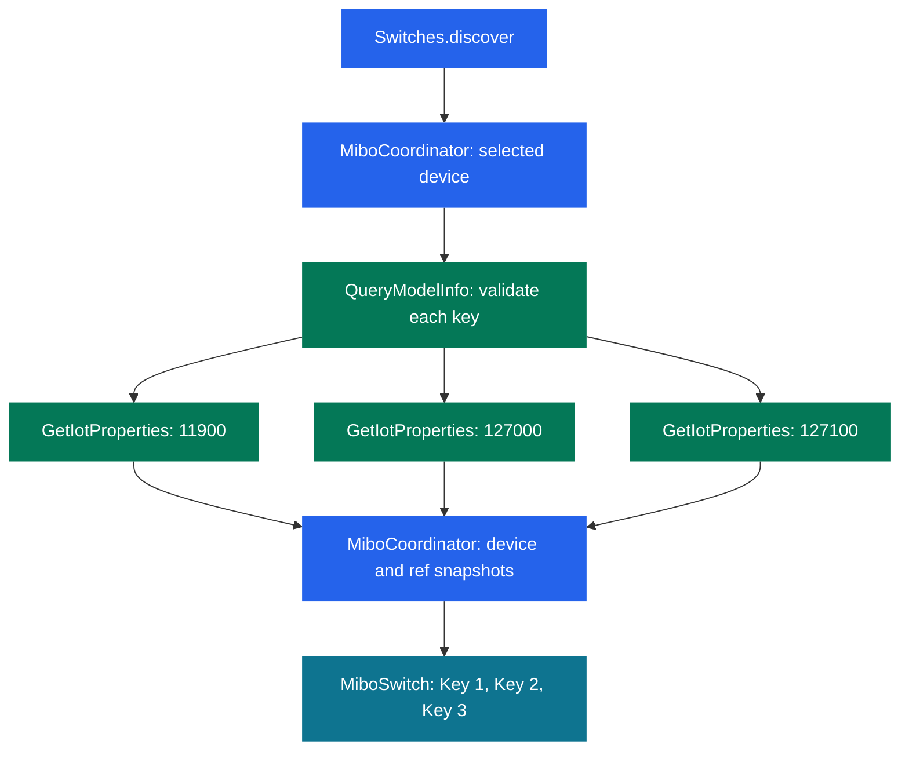
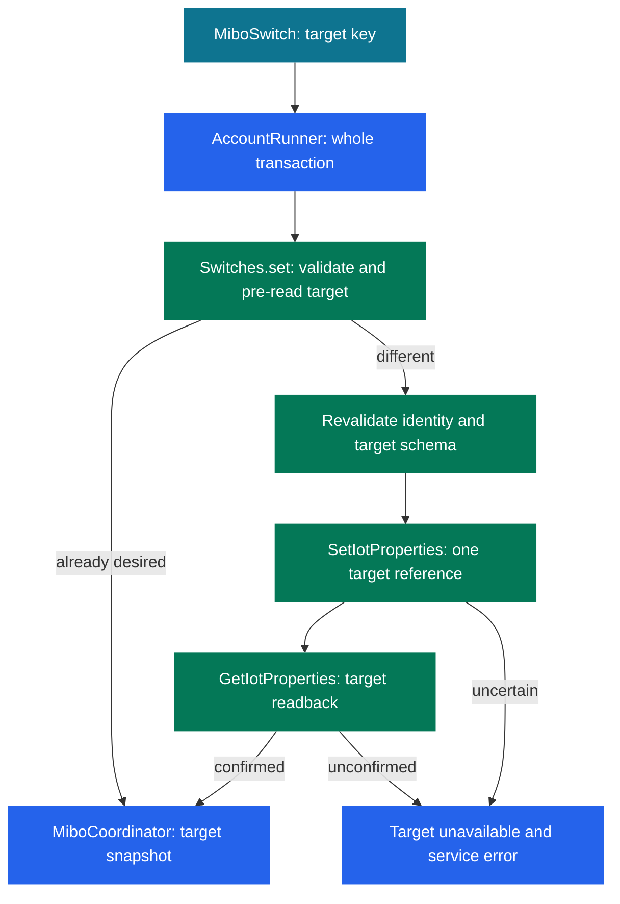

# Three EIW 1003 Switch Keys - Plan

## Goal Capsule

- **Objective:** Users can see and independently control all three keys of each selected supported EIW 1003 in Home Assistant.
- **Means:** Extend the existing native switch entities with the three schema-validated property references (KTD1–KTD3).
- **Authority:** This extension supersedes only the initial first-key support boundary in `docs/plans/2026-10-30-1341-feat-intelbras-mibo-hacs-integration-plan.md` and `AGENTS.md`. Preserve the other repository constraints and initial-plan decisions. Product requirements govern behavior; technical decisions govern implementation within them.
- **Execution profile:** Two coherent units, delivered through the existing `feat/hacs-integration` branch and draft PR #1. The parent integrates worker changes, verifies, reviews, deploys the component, and updates that PR. No new PR, merge, tag, or release.
- **Stop conditions:** Stop a live operation outside R7 or an implementation that requires weakening schema validation or changing stored account identity. Missing live evidence does not block fake-backed implementation.

---

## Product Contract

### Summary

Expose Key 1, Key 2, and Key 3 under each selected EIW 1003 device. Retain existing configuration and entities while validating and reporting each key independently.

### Problem Frame

After account setup, the user sees three switches but only one key on each. The initial implementation intentionally supported property `11900` alone; the remaining two independently addressable keys are absent.

### Requirements

**Entities and compatibility**

- R1. Each selected supported EIW 1003 has three native switch entities, named Key 1, Key 2, and Key 3, under its existing Home Assistant device.
- R2. Preserve the existing Key 1 unique ID, device registry identity, user entity customization, account session, and device selections across upgrade; no password entry or reconfiguration is required.
- R3. An unvalidated or unreadable key is unavailable and cannot be written; its failure must not suppress healthy sibling keys or other devices.

**Commands and lifecycle**

- R4. A command addresses only the selected key, preserves absolute on/off behavior, sends at most one write, and publishes only verified cloud state; an uncertain outcome is never replayed.
- R5. Preserve serialized account transactions, one complete discovery snapshot per refresh, account-wide authentication failures, and existing options, reauthentication, unload, and reload behavior.

**Scope and verification**

- R6. Support only the existing EIW 1003 model identities and the three individual keys; exclude master control, cameras, other models, LAN protocols, session import, new services, and unrelated authentication changes.
- R7. Automated verification uses synthetic data and offline fakes. Only the parent may perform authorized live reads; this change does not authorize actuation of keys 2/3 or expand the previously authorized key-1 device scope.
- R8. Keep the runtime self-contained and public artifacts free of private identifiers, credentials, raw account payloads, private paths, and private repository links. Preserve both NOTICE files and the existing license.

### Acceptance Examples

- AE1. Covers R1, R2. Upgrading an existing entry adds Key 2 and Key 3 to each selected device; Key 1 retains its entity ID, unique ID, device association, and user name.
- AE2. Covers R3. A model with only a valid Key 1 property still exposes a working Key 1; Key 2 and Key 3 remain unavailable. A subsequent valid refresh restores those entities without reload or duplication.
- AE3. Covers R3, R4. A timed-out Key 2 write marks only Key 2 unavailable, leaves sibling snapshots intact, raises the normal service error, and never sends the write again.
- AE4. Covers R5. Deselecting a device removes all three of its entities from that entry while retaining every selected device and other account's records.

### Scope Boundaries

The MFA report about a first failed code attempt is separate follow-up work. Do not alter authentication messages or flow behavior here.

Considered and not built: dynamic entity creation driven by firmware capabilities, batch property reads, persistent schema caches, adaptive polling, and new recovery abstractions. Fixed entities with per-key validation preserve compatibility and make missing properties visible; existing single-property reads have known semantics. Reconsider batch reads only if measured polling pressure requires them and partial-response behavior is validated.

---

## Planning Contract

### Key Technical Decisions

- KTD1. **Use one fixed key definition mapping.** Bind Key 1 to `switch` / `11900`, Key 2 to `std_switch2` / `127000`, and Key 3 to `std_switch3` / `127100`. These mappings come from a previously inspected EIW 1003 `QueryModelInfo` response; `std_masterSwitch` / `126900` is explicitly excluded. Treat key numbers as strict integers 1–3; reject booleans, unknown keys, and nonboolean desired states before any request. Retain the existing model and identity validation. Governs R1, R4, R6.
- KTD2. **Validate and read each key independently.** Parse model JSON once per selected device per refresh, accepting the existing object/string forms. A key is usable only when its expected identifier occurs exactly once, has its exact integer/string reference, bool data type, rw access, and no competing property with the same reference. Invalid metadata for one property invalidates that key, not valid unrelated properties; a malformed model container or failed model request invalidates the device. Request each validated reference separately using the existing request body/version and strict integer/string 0/1 parser. No guessed fallback reference or master substitution. Governs R3, R5.
- KTD3. **Nest snapshots by device and reference.** Extend coordinator data to device ID → property reference → confirmed result or unavailable. All three entities are created on setup, even if their schema or first read is unavailable; validation still gates every read/write. Preserve device identifiers and derive each unique ID as account namespace + device ID + reference, keeping `:11900` byte-for-byte. Update selected-record cleanup to retain all three known references for each selected device regardless of current availability. Governs R1–R3, R5.
- KTD4. **Keep the existing command transaction, parameterized by key.** Validate the selected key's contract, pre-read it, skip an already-satisfied write, then revalidate identity and that key's schema before writing its reference alone. Retain the existing bounded readback, cancellation/unload behavior, and error sanitization. A confirmed result replaces only the target snapshot; a non-auth command error invalidates only that key. Authentication invalidation remains account-wide. Governs R4, R5.

### High-Level Technical Design

Source: current `protocol.py` discovery/schema/read boundaries, `coordinator.py` refresh, and `switch.py` entity setup; proposed per-key extension per KTD1–KTD3. A failed branch contributes an unavailable snapshot instead of a state.

Source: existing `Switches.set`, `AccountRunner`, and `MiboCoordinator.async_set`; target isolation follows KTD4. Authentication invalidation retains the existing account-wide reauthentication path.

### Assumptions and Evidence Limits

Fixed unavailable entities for unsupported key properties are an implementation default, selected to retain stable identity and recover on ordinary polling without dynamic discovery machinery. No capability is inferred from the mere presence of an entity.

The observed product schema establishes identifiers and references, not physical button order or relay operation. Only Key 1 has prior physical validation. Keys 2/3 require user physical verification after installation; do not claim that validation from fake tests or cloud reads.

No new external API or framework design is required: extend the in-repository single-property read/write pattern and native entity lifecycle. `tests/fakes.py` currently stores one state per device; its replacement must store state and injectable failures per device/reference. Existing test helpers that index entities by device alone must also include reference, or tests will silently discard sibling entities.

### Risks and Rollout

Each healthy device now needs up to three property reads per refresh. Keep the current polling interval and account serialization; do not add concurrent cloud calls. The parent verifies that the existing installation reloads with the expected entities and read-only states. If validation fails, restore the prior component files through the normal deployment workflow and report the failure; never alter authentication storage.

---

## Implementation Units

### U1. Extend protocol, coordinator, and native entities together

**Goal:** Deliver the three-key behavior and compatibility guarantees as one coherent change.

**Requirements:** R1–R5, R7, R8; AE1–AE4; KTD1–KTD4.

**Dependencies:** None.

**Files:** `custom_components/intelbras_mibo/protocol.py`, `custom_components/intelbras_mibo/coordinator.py`, `custom_components/intelbras_mibo/switch.py`, `custom_components/intelbras_mibo/__init__.py`, `tests/fakes.py`, `tests/test_protocol.py`, `tests/test_coordinator.py`, `tests/test_switch.py`, `tests/test_init.py`; adjust `tests/conftest.py` or existing config-flow tests only where their fixture contracts require it.

**Approach:**

1. Add the single shared key mapping and parameterize protocol validation/results/read/write behavior per KTD1, KTD2, KTD4.
2. Extend coordinator snapshots and native entity construction per KTD3 while preserving `AccountRunner` ownership and command serialization.
3. Extend registry cleanup and fake cloud fixtures together; retain current auth/bootstrap/session interfaces and stored configuration formats.

**Patterns to follow:** Existing `Switches.set` confirmation/error handling, `MiboCoordinator` authentication escalation, `MiboSwitch.device_info`, and native service/registry tests. Do not introduce another runtime or generalized property framework.

**Test scenarios:**

1. Parameterize native on/off/no-op services over all three keys; each write contains only its mapped reference and preserves sibling states. Strictly reject unsupported keys and nonboolean command inputs before requests.
2. Validate object and string schemas, exact bool/rw metadata, wrong or duplicate identifiers/references, and strict binary reads. A malformed Key 2 property/read leaves valid keys 1/3 working; a Key 1-only schema preserves Key 1 and blocks writes to unavailable siblings.
3. Covers AE2. Recover a missing/invalid property or failed read on ordinary refresh without changing entity IDs; refresh uses one complete BasicList traversal and one model request per selected device.
4. Covers AE3. Parameterize uncertain writes, acknowledged-but-unconfirmed readback, and schema changes before writes over added keys. Assert no replay, no optimistic publication, target-only invalidation, and later poll recovery; auth invalidation still affects the account.
5. Covers AE1. Seed an existing Key 1 registry record with custom entity ID/name and device association; setup/reload adds siblings while preserving that record and stored account/options. Include a second account with the same synthetic cloud device ID to prove isolation.
6. Covers AE4. Options deselection removes all three records for only that device/entry. Reload, same-account reauthentication, rename, and list reordering retain all selected entity identities.
7. Extend the existing cancellation/unload test to an added-key command: queued whole transactions do not interleave, unload drains active work, late publication is rejected, and reload creates no duplicate entities.

**Verification:** Focused protocol/coordinator/switch/init tests pass in the pinned environment; whole-integration checks demonstrate native services and registries rather than only protocol mocks.

### U2. Document support and verify installation

**Goal:** Make the documented support boundary and deployed behavior match U1.

**Requirements:** R1–R8.

**Dependencies:** U1.

**Files:** `README.md`, `docs/protocol.md`, `docs/development.md`, `AGENTS.md`; `custom_components/intelbras_mibo/manifest.json` only if the parent needs a new component version for the installation update.

**Approach:** Update first-key-only claims, explain unavailable unsupported properties and per-key failure isolation, and state the physical-verification limit. Amend AGENTS scope to the three supported keys while preserving live-access restrictions. Keep the original initial plan as historical context; this extension is the new support-boundary authority. A version bump is metadata, not a tag or release.

**Test expectation:** No prose-mirroring tests. Review statements against U1 and verify installation through the Verification Contract.

**Verification:** Documentation and distributable files contain only portable synthetic examples, and the parent records actual fake-backed and live-read results separately.

---

## Verification Contract

Follow `AGENTS.md` and `docs/development.md` with Home Assistant 2026.10.4, Python 3.14.9, and pytest-homeassistant-custom-component 0.13.375. Run `scripts/check tests/test_protocol.py tests/test_coordinator.py tests/test_switch.py tests/test_init.py` for affected behavior and then `scripts/check` for integration. Keep network sockets disabled. Run `git diff --check` for the complete diff.

Run hassfest and HACS validation from `.github/workflows/validate.yml` if metadata/packaging changes, and record their results separately. Verify component-only fresh-instance setup and all three native service paths with fakes; check native options/reauth forms through the existing browser smoke workflow. Reuse passing checks unless new changes invalidate them.

Before deployment, the parent runs the existing Home Assistant configuration check, copies only the custom component, and reloads/restarts through supported operations. Verify the existing account and selections survive, each of the user's three selected devices has three entities under one device, Key 1 retains identity, and readable cloud states agree with displayed states. Make no live Key 2/3 actuation; request user physical verification after installation. Keep hosts, tokens, and device identifiers out of public output.

---

## Definition of Done

- U1 passes its behavior tests and the full pinned offline suite, including stable upgrade identity and per-key failure isolation.
- U2 documentation describes the three-key support boundary accurately; required validators and smoke checks are reported with actual evidence or a precise remaining limitation.
- The parent reviews the implementation against this plan, resolves material findings, updates the existing PR, and records the deployment/read-only verification result.
- No unrelated auth fix, new runtime dependency, secret/private identifier, abandoned experiment, master-control path, merge, or release enters the change.
- The user receives the installed result and the remaining physical verification request for keys 2/3; cloud confirmation is not described as physical confirmation.
