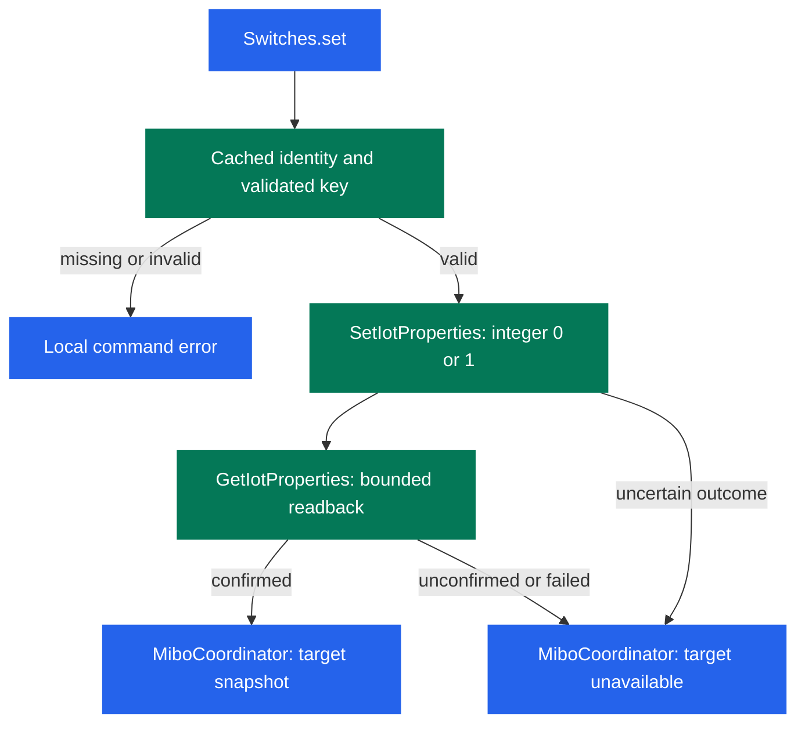

# Direct cached switch commands

## Goal and authority

Remove the five command preflight network queries from an ordinary warmed switch
command. Use the existing cached device identity and previously validated key
metadata so that the first cloud request is the absolute property write, followed
by the existing bounded readback.

The user's current instruction explicitly authorizes this change: remove all
command discovery, schema, and state pre-reads; do not skip a write because the
last observed state already matches. This plan supersedes only the command
preflight and already-satisfied no-op contract in the initial integration and
three-key extension plans. Keep those plans unchanged as historical records.
All other support, authentication, lifecycle, privacy, and live-access bounds
remain in force.

## Implementation approach

Keep a minimal in-memory `Switches` cache of supported device identity and
validated metadata per device and key. Build and replace it during ordinary
refresh, using the existing discovery snapshot and model validation. Remove
cached targets when devices disappear, identities change, or their schema fails
validation. A malformed or failed model request cannot retain previously valid
metadata. A property state-read failure alone does not invalidate valid identity
and schema metadata; no observed state is required for an absolute write.

`Switches.set` validates its local selector, key, boolean input, and cached
metadata, then sends `SetIotProperties` for only the mapped reference with integer
`0` or `1`. Missing or invalid metadata fails locally without a network fallback.
A valid command sends exactly one write even if the last confirmed state matches.
Retain the existing acknowledgement handling and up to three readback attempts,
with up to two seconds between reads and a five-second scheduling window. A
single transport request may exceed that window. Publish only confirmed cloud
state. Never replay uncertain writes or acknowledge a write as confirmed without
matching readback.

Normal polling remains every 30 seconds. Account transactions remain serialized,
and the HTTP transport remains unchanged. A command may still wait behind an
active refresh. Removing preflight requests is not evidence that total command
latency is resolved.

Source: existing `protocol.py` `Switches.set`, `coordinator.py` `async_set`, and
`runtime.py` account serialization; proposed command path under this plan.

## Acceptance and tests

- Warm commands for each of the three keys start with `SetIotProperties`, followed
  only by existing bounded readback requests. No `BasicList`, `QueryModelInfo`, or
  property-state request occurs before the write.
- Both on and off write exactly one mapped property with strict integer `1` or
  `0`. An already-matching state still produces one write. Sibling keys retain
  their confirmed states.
- Invalid selectors, keys, nonboolean desired states, and missing or invalid
  cached targets fail locally without requests. No command-time discovery or
  schema fallback is introduced.
- Normal refresh populates valid targets, removes stale device/key metadata on
  disappearance or failed schema validation, and restores targets after a valid
  refresh. A failed property read does not itself discard valid target metadata.
- Uncertain writes are never retried. Unconfirmed readback leaves the target
  unavailable; later polling can recover it. Non-authentication command failures
  remain target-only, while invalid authentication retains account-wide handling.
- Preserve cancellation, unload/reload, account serialization, stored session and
  options formats, entity identity, and the three-key support boundary.

Add or update the protocol behavior tests and affected coordinator/native-service
checks. Use synthetic identities and fake cloud calls with network sockets
blocked. Do not add tests that merely repeat documentation text.

## Exclusions

No polling interval change, concurrency change, HTTP transport change, TTL,
persistent metadata cache, new option, state pre-read, no-op optimization, blind
retry, batch property read, generalized cache framework, or authentication fix.
No support expansion, new service, merge, tag, or release. Version `0.2.1`
identifies the component patch for installation testing only. Preserve the MIT
license and both NOTICE files.

Workers make no cloud calls or device actions. Existing parent-only live scope
remains limited to the privately pinned Key 1 device; this plan grants no Key 2/3
actuation and includes no private identifiers or paths.

## Verification needed

Run `scripts/check tests/test_protocol.py tests/test_coordinator.py tests/test_switch.py tests/test_init.py`
and the full `scripts/check` in the pinned environment, plus `git diff --check`.
Parse the manifest JSON and run the hassfest and HACS jobs in
`.github/workflows/validate.yml` for the version metadata change. Report remote
repository prerequisites separately from component failures.

Retain the component-only fresh-instance fake-backed setup/service checks and
native-form smoke requirements in `AGENTS.md` and `docs/development.md`; reuse
existing passing evidence only when this change does not invalidate it. There is
no new UI to inspect. Only the parent may perform installation checks or any
already authorized live measurement. Record actual check results separately;
this plan does not claim tests, deployment, or live latency measurement passed.
