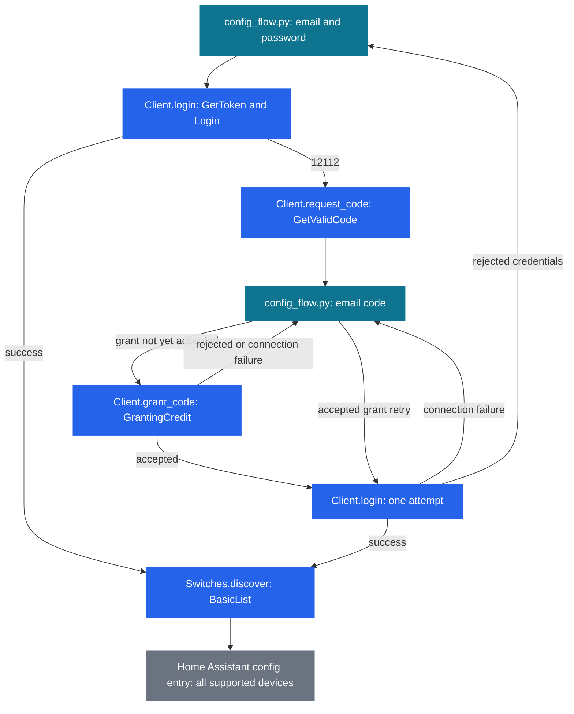
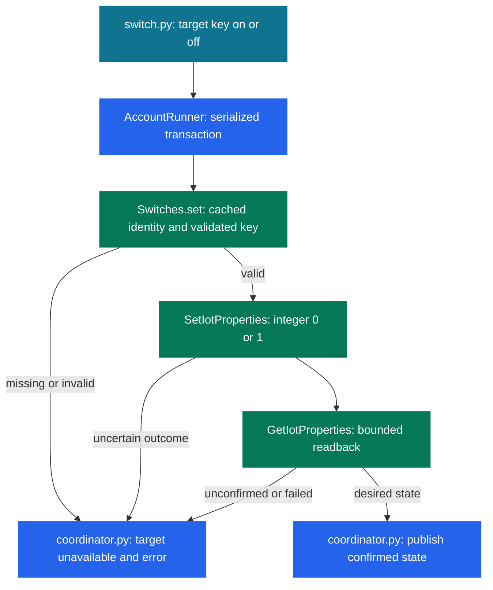

# Protocol and storage

This document describes the implementation in
`custom_components/intelbras_mibo/{protocol,bootstrap,runtime,config_flow,coordinator,switch}.py`.
The reverse-engineered cloud protocol is adapted from the public MIT-licensed
MiboMac source named in [NOTICE](../NOTICE). It does not implement a local-LAN
protocol or rely on a separately installed CLI.

## Verified bootstrap

`bootstrap.py` pins the immutable source URL:

```text
https://raw.githubusercontent.com/Saeger/MiboMac/9ef8108e3992b60ff4ef0d9e1d84b8fc6e8e020f/Sources/App/MiboAPI.swift
```

Its expected SHA-256 is:

```text
be30e1c992a73a1d35515e084cf418e8e8a82b10a4e9d8228b08b5b5e0c394f4
```

The downloader rejects redirects, ignores environment proxies, limits input to
2 MiB, and uses a 20-second request timeout. The digest is checked before UTF-8
parsing. Static extraction requires exactly one string-literal declaration for
each of `appId`, `defaultAK`, `defaultSK`, `clientVersion`, `project`, and
`protocolVersion`. Downloaded source is never executed. These names describe the
fields; their application credential values must not be committed or logged.

Home Assistant's private `Store` named `intelbras_mibo.bootstrap` caches a version,
source URL, digest, and the six fields. Only the expected shape and pinned
provenance are accepted. Missing or invalid cache data requires a fresh verified
download; failure stops setup. A valid cache avoids upstream source access, but
normal operation still requires the Mibo cloud. Use Home Assistant storage APIs,
without manually changing `.storage` files.

## Authentication and discovery



Source: `config_flow.py` credential, code, authentication, and discovery steps;
`protocol.py` login, request-code, grant-code, and discovery methods.

Only login error `12112` requests an email code. Submitting a code grants terminal
trust and makes one login attempt. A rejected code stays on the code form without
sending another email. Transport failures, HTTP 5xx responses, and malformed
provider responses during initial login, code grant, or post-grant login report
a connection error. Malformed responses include `invalid_response`,
`invalid_data`, `api_invalid_code`, and `invalid_login_response`. During login,
only numeric `api_*` provider rejections, HTTP 401/403, `login_required`, and
`login_failure_no_retry` report rejected credentials; the specific `12112`
challenge still opens email verification. After an accepted grant, flow-local
memory retains that fact;
retrying resumes login without granting the code again. Rejected credentials
after a grant return to the credentials form. Passwords and verification codes
stay in flow memory, without being persisted. An entry is created only after
discovery finds at least one supported device. Account identity is based on a trimmed, case-folded email;
duplicate account entries are rejected.

The config entry holds the email, canonical account, SHA-256 account namespace,
and token session. The session contains its format version, token username,
token, optional session ID, approved cloud host, and terminal ID. Known cloud
device IDs are retained in entry options; last known names are retained through
Home Assistant device and entity registries using their public APIs. These are
sensitive configuration data even though no password or code is stored.

A restored authenticated session rejected with HTTP 401 or API `12112` is marked
invalid and requests Home Assistant reauthentication. Other errors, including
HTTP 403, are not assumed to mean expiry. Reauthentication requires the original
account and preserves terminal ID, known devices, and entity identity. There is
no manual selection step or options filter.

## Transport and device validation

`Client.call` sends JSON POST requests to an explicit HTTPS host and endpoint
allowlist. The request signs its method, path, body digest, content type, and
ordered protocol headers using HMAC-SHA256. Login exchanges account credentials
for a token session. There is no automatic token-refresh contract.

Cloud transport rejects redirects, environment proxies, unapproved endpoints,
responses larger than 2 MiB, and invalid response structures. Each request has a
20-second timeout; that is not a deadline for a whole multi-request operation.
Device discovery follows bounded pagination and rejects repeated cursors and
ambiguous duplicate device IDs. Errors expose bounded identifiers rather than
server descriptions, response bodies, or authentication headers.

Discovery accepts only model identifiers `IOT-EIW1003-IB` or `EIW1003`, complete
nonempty device identity fields, an empty channel list, channel count zero, and a
string gray flag. Invalid candidates are omitted independently. During normal
refresh, the model schema must validate each key's fixed mapping before it can
be read or cached for commands:

| Entity | Identifier | Reference |
| --- | --- | --- |
| Key 1 | `switch` | `11900` |
| Key 2 | `std_switch2` | `127000` |
| Key 3 | `std_switch3` | `127100` |

`protocol.py` defines this mapping in `KEYS`. Key arguments must be integers
1–3; booleans and unknown keys are rejected before requests. Desired states
must be booleans. Each identifier must occur exactly
once, with its exact integer or string reference, `bool` data type, and `rw`
access. No other property may share that reference. Model JSON may be an object
or a JSON string; a malformed model container invalidates the device. Invalid
metadata for one key leaves valid unrelated keys usable. Each validated key is
read separately, accepting only integer or string `0` and `1`. No camera,
channel, guessed-reference, or master-control fallback is attempted.

Read-only cloud checks confirmed these properties and readable states. Schema
support does not establish physical button order or relay operation. User-observed
control of all three property keys was verified on an existing installation,
with the original states restored. This does not establish physical button order,
other-model coverage, or command latency.

## Commands and polling



Source: `switch.py`, `runtime.py` account runner, `protocol.py` `Switches.set`,
and `coordinator.py` `async_set`.

An absolute on/off command targets only its mapped property, using the identity
and validated key metadata already cached in memory by `Switches` during normal
refresh. Missing or invalid cached metadata fails locally without discovery,
schema requests, or a state read. With valid metadata, the first cloud request
is `SetIotProperties` with the target reference and integer `0` or `1`. Each
accepted command sends exactly one write, including when the last confirmed
state already matches. There is no pre-read or already-satisfied shortcut.
Acknowledged writes get up to three readback attempts, with
up to two seconds between reads and a five-second readback scheduling window.
An individual transport request can extend beyond that window. Timeout or an
uncertain write never causes an automatic replay. Acknowledgement without the
desired readback is also a failure. These checks establish cloud property state,
not physical relay or load confirmation.

`MiboCoordinator` polls every 30 seconds, sharing one discovery snapshot across
all supported devices plus retained known IDs. It parses each device's model
once and validates and reads its three keys independently. Refresh also builds the per-device/per-key validated
command metadata cache. Disappeared devices, replaced identities, and failed
schema validation remove the corresponding old cached metadata. The cache has
no separate persistence, TTL, or network fallback. A property read failure alone
does not discard validated command metadata. Snapshots are indexed by
device ID and property reference. An invalid or unreadable key is unavailable
while healthy sibling keys and other devices can update. A device-level failure makes all its keys
unavailable. A non-auth command failure invalidates only its target key; a
successful command replaces only that key's confirmed snapshot. Later polling
can restore an unavailable key without replaying a write. Shared
discovery/transport failures affect the account; invalid authentication starts
reauthentication. Entity states are never updated optimistically after a write.
Coordinator refresh and command publications preserve their transaction order,
so an older refresh
cannot overwrite a newer confirmed command state.

`AccountRunner` sends synchronous work to Home Assistant's executor and shares a
thread lock across clients for the same account. Complete discovery and command
transactions are serialized, including after cancellation of an awaiting
coroutine. Commands can still wait behind an active periodic refresh; removing
command preflight requests does not establish total command latency. Unload
stops new work and publications, drains running work, and releases the runtime
before replacement. Device and entity identities combine
the account namespace with cloud device ID; each entity adds its mapped property
reference. Key 1 retains the existing `:11900` suffix byte-for-byte. All three
entities are created even when a key's initial schema or read is unavailable.
This keeps accounts separate and preserves identity across renames and reauth.
Upgrades retain the stored account/session format, existing known IDs, and device
and Key 1 registry records, including custom entity IDs and names. No new setup
is required. Normal refresh unions all supported discovered IDs with the known
IDs; it never replaces the known set with the current cloud list. Newly found
IDs are persisted using Home Assistant config-entry APIs. Last known names are
retained through the device and entity registries, without adding a names field
to entry options.
A missing device keeps its remembered name after restart and all three keys
remain present but unavailable. Authentication or discovery failures do not
remove known devices or registry records.

The switch platform subscribes to coordinator updates and adds the three key
entities for each new ID once per platform load. Repeated polls, cloud list
reordering, renames, command publications, and a device returning online do not
add duplicates. Unload unregisters that listener before the runtime is replaced.
No discovery, setup, options, or unload path automatically deletes device or
entity registry records. The additive-discovery plan supersedes the earlier
manual-selection and deselection cleanup contract only; the direct cached-command
contract above is unchanged.
